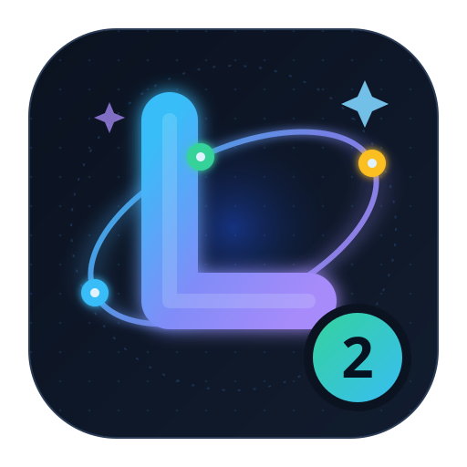
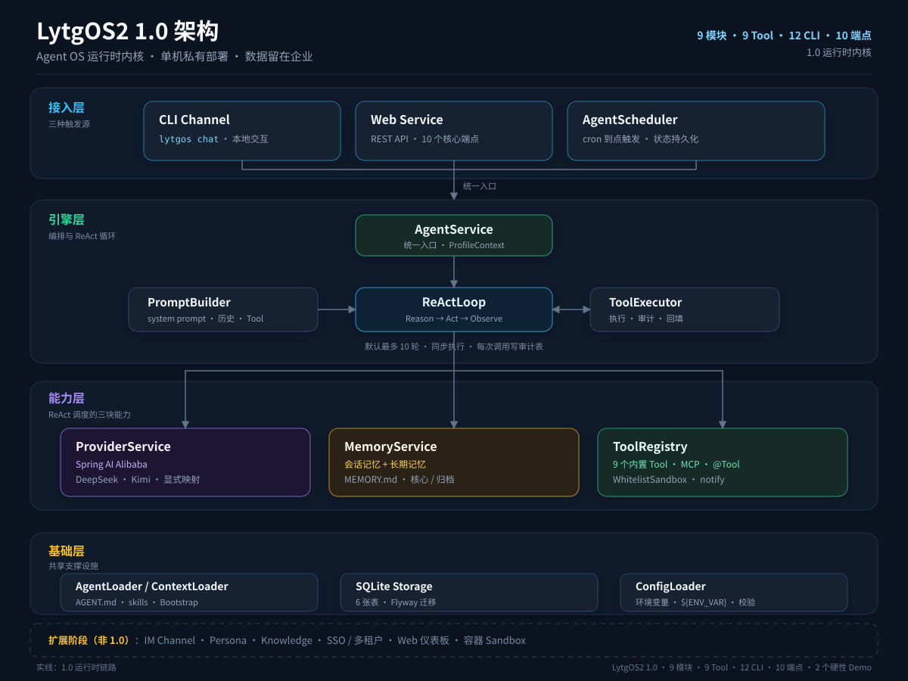

<div align="center">
  

  <h1>LytgOS2</h1>

  <p><strong>A Java-native, self-hosted, auditable enterprise Agent OS.</strong></p>
  <p>Install an Agent foundation the way you install a Spring Boot application.</p>

  <p>
    
    
    
    
    
  </p>

  <p>
    English · <a href="readme.zh.md">简体中文</a>
  </p>
</div>

LytgOS2 is installed on an enterprise's own Kubernetes clusters, servers, or bare metal as the unified foundation for running a fleet of business agents. Ops assistants, customer service assistants, HR assistants, sales assistants, and knowledge management assistants all run on the same instance, sharing channel access, model routing, tool calling, memory, sandboxing, and auditing. Data stays entirely on the enterprise's own infrastructure, with no lock-in to any cloud ecosystem.

Business teams do not write agent backend code: **write an agent directory with an `AGENT.md`, configure the model and tools, and the agent runs.**

---

## Table of Contents

- [Project Overview](#project-overview)
- [Project Status](#project-status)
- [Why LytgOS2](#why-lytgos2)
- [Core Features](#core-features)
- [Architecture](#architecture)
- [Quick Start](#quick-start)
- [Usage](#usage)
- [Configuration](#configuration)
- [Project Structure](#project-structure)
- [Compatibility](#compatibility)
- [Documentation](#documentation)
- [Roadmap](#roadmap)
- [Security Notes](#security-notes)
- [Contributing](#contributing)
- [License](#license)
- [Acknowledgments](#acknowledgments)

---

## Project Overview

LytgOS2 is an enterprise-grade **Agent OS** implemented in Java. It is not an agent framework, nor a workflow orchestration platform, but a runtime foundation installed on the enterprise's own infrastructure: above it, it carries multiple business agents; below, it unifies access to models, tools, memory, channels, and auditing.

It answers the question: "When an enterprise runs N agents at the same time, what should the infrastructure they share look like?"

| Dimension | LytgOS2 | Orchestration platforms (Dify/Coze) | Frameworks (Spring AI/LangChain4j) |
|---|---|---|---|
| Output | Configured, always-on agents | Executable workflow processes | Code (libraries / SDKs) |
| Users | Business teams (configuration) + developers (writing tools) | Business users / developers | Developers |
| Runtime | Installed on the enterprise's own infrastructure | The platform's own runtime | Built by developers themselves |
| Relationship to LytgOS2 | — | Can serve as an upper-layer client of LytgOS2 | Reused inside LytgOS2 for LLM calls |

**Agent OS vs. agent runtime:** a runtime gets one agent running; an Agent OS gets a fleet of agents managed within an enterprise. LytgOS2's core includes an agent runtime, but on top of it provides multi-agent lifecycle, unified access, unified memory, auditing, and governance.

---

## Project Status

LytgOS2 is currently in the **engineering foundation phase**. The nine-module skeleton and quality gates are in place; business features are next. The scope, naming, and acceptance criteria for 1.0 are locked in [`docs/ReleaseBaseline.md`](docs/ReleaseBaseline.md).

| Item | Status |
|---|---|
| Industry research, requirements, technical solution | ✅ Done |
| 1.0 scope baseline | ✅ Done |
| Maven project and Java code | ✅ Nine-module skeleton complete; business features not implemented |
| Runnable version / CLI | 🚧 Boot jar starts (health/info); agent features and CLI subcommands not implemented |
| Tests, CI, quality gates | ✅ Engineering foundation installed |
| Agent business features | 🚧 Not started |

> The repository contains an initialized nine-module Maven skeleton plus the engineering foundation: Maven Wrapper, Spring Boot 3.5.16, Spring AI 1.1.2 + Spring AI Alibaba 1.1.2.4-security-fix, unified API envelope, OpenAPI, structured logging, virtual threads, and Spotless/Checkstyle/PMD/SpotBugs/ArchUnit/JaCoCo gates. `./mvnw clean verify` passes; `lytgos-boot` exposes `/api/v1/health`, `/api/v1/info`, and `/v3/api-docs`. Agent business features and CLI subcommands are not implemented yet.

### 1.0 Delivery Scope

| Item | 1.0 |
|---|---|
| Maven modules | 9 |
| Built-in tools | 9 |
| CLI commands | 12 |
| REST endpoints | 10 core endpoints + supporting management endpoints |
| SQLite tables | 6 |
| Acceptance demos | 2 mandatory + 1 optional |
| JDK | 21 |

---

## Why LytgOS2

**What enterprises need is not "yet another agent framework", but a foundation they control themselves.** Heavily regulated enterprises have constraints that do not change: core data must not leave the enterprise, systems must be fully auditable, new components must pass existing security processes, and the tech stack must align with the existing system. SaaS and cloud-locked products cannot pass these constraints.

**Open-source Agent OS projects have validated the design.** OpenClaw validated "an agent foundation installed on your own machine" with Node.js, and Hermes Agent validated engineering-grade robustness with Python. But both started from individuals and small teams, leaving enterprise governance and deep integration with enterprise IT systems open.

**The Java ecosystem has frameworks, but no foundation.** Spring AI, Spring AI Alibaba, and LangChain4j solve LLM calls and agent development libraries. But if a Java enterprise wants a private, controllable, auditable agent foundation, today it can only cross stacks to Node.js or Python projects and write a lot of glue to integrate with existing Java systems.

What LytgOS2 anchors on is not the possibly dated term "Agent OS", but requirements of regulated enterprises that will not change: **private deployment, full auditability, data staying on-premises, integration into existing IT governance, and alignment with the existing Java stack.**

---

## Core Features

| Feature | Description |
|---|---|
| **LLM connectivity** | Provider abstraction with explicit provider-name mapping; agents do not know which vendor's model is being called; 1.0 runs DeepSeek and Kimi end to end at a minimum |
| **ReAct loop** | Self-implemented Reason + Act loop; the LLM decides which tool to call, sees the results, and continues reasoning until it produces a final response |
| **Two-layer Memory** | Session memory + long-term memory; a single `MemoryService` facade; 1.0 long-term memory uses `MEMORY.md` with core/archive partitions |
| **Tool system** | 9 built-in tools, an MCP client, and `@Tool` Java beans; zero-code integration of existing MCP servers, or write your own MCP server |
| **Web Service** | 10 core REST endpoints for business systems to integrate over HTTP; CLI, REST, and scheduled tasks share the same agent pipeline |
| **CLI Channel** | `lytgos chat/serve/gateway` — three run modes sharing the same Profile and Session storage |
| **Scheduled tasks** | `AgentScheduler` triggers on cron; status and execution history are persisted to SQLite, queryable and manually re-runnable |
| **Auditing foundation** | `tool_invocations` and `llm_calls` are written from day one, not reverse-parsed from logs later |
| **Contracts first** | Provider, Memory, Sandbox, and Notify all define interfaces before implementations; extensions swap implementations without changing callers |

### Built-in Tools (9 in 1.0)

`read_file`, `write_file`, `list_dir`, `shell`, `http_get`, `http_post`, `save_memory`, `recall_memory`, `notify`.

File, shell, HTTP, and notification tools all pass through `WhitelistSandbox`'s application-level allowlist before execution.

---

## Architecture

<p align="center">
  <a href="docs/images/architecture.svg">
    
  </a>
</p>

<p align="center"><sub>Solid lines are the 1.0 runtime paths; dashed areas are reserved for the extension phase. Click the image to view the full SVG.</sub></p>

Three trigger sources—CLI pushed by a person, HTTP calls, and clock-driven scheduled tasks—all converge into `AgentService.process`. The engine does not care which entry point a message came from.

`PromptBuilder` assembles each turn: agent instructions + Bootstrap + Memory + conversation history + available tool list, and injects the current date and time at the end. `ReActLoop` runs up to 10 iterations by default, and every LLM call and tool call is written to the audit tables.

1.0 is a Spring Boot monolith composed of nine Maven modules, deployed as a single binary. See [Project Structure](#project-structure) for module responsibilities.

---

## Quick Start

> ⚠️ The repository currently has no runnable code. The commands below are the target 1.0 usage and are not executable yet.

### Requirements

| Item | Requirement |
|---|---|
| JDK | 21 (1.0 baseline) |
| Maven | 3.x |
| Deployment OS | Major Linux distributions (Ubuntu 22.04+, CentOS 8+, Debian 11+, Alibaba Cloud Linux 3, Rocky Linux) |
| Development OS | Windows / macOS / Linux |

### Build and Start the Skeleton

```bash
git clone <repository-url>
cd lytgos2
./mvnw clean verify
java -jar lytgos-boot/target/lytgos-boot-1.0.0-SNAPSHOT.jar
```

Windows uses `mvnw.cmd` instead of `./mvnw`. `mvn verify` runs the full quality gate; `mvn package` does not.

Verify after startup:

```bash
curl http://localhost:8080/api/v1/health
```

> The current skeleton exposes the `health` / `info` system endpoints and OpenAPI at `/v3/api-docs`; agent features are not implemented yet. The repository URL and Git repository will be provided before the 1.0 release.
>
> Maven must run on JDK 21. If `mvn -v` does not show JDK 21, point `JAVA_HOME` to JDK 21 first.

### Planned Agent Usage

The following commands become available after US-1 / US-2 are complete:

```bash
lytgos init
lytgos profile create daily-weather

# Edit .lytgos/agents/daily-weather/AGENT.md to configure provider, tools, and task instructions
lytgos chat --profile daily-weather
lytgos serve
lytgos gateway
```

---

## Usage

### One Directory = One Agent

Agents are not written as code; an agent is a self-contained directory:

```text
.lytgos/agents/daily-weather/
├── AGENT.md          # frontmatter = runtime config, body = task instructions
├── skills/           # relative symlinks to .lytgos/skills/<name>/
├── scripts/          # optional scripts
└── REFERENCE.md      # optional reference material
```

`AGENT.md` example:

```markdown
---
name: daily-weather
description: Daily weather and outfit suggestions
identity:
  agent_name: Weather Assistant
  prompt: You are a thoughtful weather and outfit assistant
provider:
  name: deepseek
  model: deepseek-chat
tools:
  - http_get
  - notify
channels:
  - name: cli
bootstrap:
  - AGENTS.md
  - SOUL.md
  - USER.md
settings:
  max_iterations: 10
  max_history_turns: 20
---

You are responsible for checking the weather every day, generating concise outfit suggestions, and pushing them to the enterprise IM group via notify.
```

- The `AGENT.md` body and Bootstrap files are always present in the system prompt.
- Global skills live in `.lytgos/skills/<name>/`; an agent selects its visible set via relative symlinks under its own `skills/`.
- Each turn injects only the name, description, and local path of bound skills; bodies, scripts, and references are read on demand via `read_file`/`shell`.
- The agent directory is a context source, not a tool, and does not enter the `ToolRegistry`.

### CLI

```bash
lytgos init                              # Initialize the workspace
lytgos status                            # Show configuration and runtime status
lytgos chat [--profile <name>]           # Interactive chat
lytgos serve                             # Start the HTTP API
lytgos gateway                           # Start the multi-channel daemon
lytgos profile list|create|show|delete   # Manage agent directories
lytgos provider list                     # List configured providers
lytgos tool list                         # List registered tools
lytgos session list                      # List session history
```

### HTTP API (Core Endpoints)

| Category | Endpoints |
|---|---|
| Session management | `POST /api/v1/sessions`, `POST /api/v1/sessions/{id}/messages`, `GET /api/v1/sessions/{id}`, `DELETE /api/v1/sessions/{id}` |
| Agent invocation | `POST /api/v1/agents/{name}/invoke` |
| Queries | `GET /api/v1/profiles`, `GET /api/v1/memory`, `GET /api/v1/tools` |
| System status | `GET /api/v1/health`, `GET /api/v1/info` |

1.0 also provides supporting management endpoints for `notify-channels` and `scheduler v2`; see the baseline document for details.

---

## Configuration

### Naming Conventions

| Item | Value |
|---|---|
| Product name | **LytgOS2** |
| CLI | `lytgos <command>` |
| Workspace | `.lytgos/` |
| SQLite database | `.lytgos/lytgos.db` |
| Maven modules | `lytgos-*` |
| Spring configuration prefix | `lytgos.*` |
| Java class name prefix | `Lytgos*` (e.g. `LytgosCli`) |

### Workspace Structure

The LytgOS2 workspace defaults to `.lytgos/`:

```text
.lytgos/
├── agents/            # one agent per subdirectory
├── skills/            # global skill library
├── memory/
│   └── MEMORY.md      # long-term memory
├── sessions/          # session data
├── logs/              # structured logs
├── output/            # agent outputs
├── mcp_servers.yaml   # MCP configuration
├── AGENTS.md          # Bootstrap: project-level behavior notes
├── SOUL.md            # Bootstrap: default persona
├── USER.md            # Bootstrap: user preferences
└── lytgos.db          # SQLite
```

### Configuration and Secrets

- Sensitive configuration is loaded from environment variables or local standalone config files; `AGENT.md` uses `${ENV_VAR}` placeholders.
- `mcp_servers.yaml` declares an MCP server's `name`, `transport`, `command`, and `env`.
- 1.0 provider credentials are never written into `AGENT.md` or committed to the repository.
- 1.0 assumes intranet deployment and has no authentication or RBAC.

---

## Project Structure

The root `pom.xml` is an aggregator parent POM (`packaging=pom`) with no source code; all code lives in the nine modules below.

The current executable entry point is `LytgosApplication` in `lytgos-boot` (a Spring Boot fat JAR); `LytgosCli` in `lytgos-cli` is a Picocli command skeleton, not yet packaged into an executable `lytgos` command.

| Module | Responsibility |
|---|---|
| `lytgos-core` | Core contracts and engine: `LytgTool`, `Session`, `Profile`, `AgentLoader`, `ContextLoader`, `ReActLoop`, `PromptBuilder`, `ToolExecutor`, `AgentService`, `AgentScheduler` |
| `lytgos-provider` | `ProviderService`, function-calling adaptation, explicit provider name → `ChatModel` mapping |
| `lytgos-memory` | `MemoryService` facade, `LongTermMemoryStore`, `MarkdownMemoryStore`, `MemoryTools` |
| `lytgos-tool` | Built-in tools, MCP client, `ToolRegistry`, `Sandbox` + `WhitelistSandbox`, `NotifyChannelAdapter` + `WebhookNotifyAdapter` |
| `lytgos-channel-cli` | `CliChannel`, the `lytgos chat` implementation |
| `lytgos-web` | `WebServer`, 6 controllers, unified exception handling, OpenAPI, supporting management endpoints |
| `lytgos-storage` | SQLite, JPA repositories, session / audit / scheduled task / notify channel persistence, Flyway migrations |
| `lytgos-cli` | Picocli main entry, 12 subcommands, `ConfigLoader` |
| `lytgos-boot` | Spring Boot main class, auto-configuration, dependency aggregation, fat JAR packaging |

Tech stack: **JDK 21 + Spring Boot 3.5.x + Spring AI 1.1.x + Spring AI Alibaba 1.1.2.x + self-implemented ReAct loop + SQLite + Picocli + MCP Java SDK**.

---

## Compatibility

| Item | Support |
|---|---|
| JDK | 21 (baseline; running on JDK 21+ allowed) |
| Operating system | Major Linux distributions; development on Windows / macOS / Linux |
| LLM protocol | The OpenAI-compatible protocol is the de facto standard; providers implementing it can be integrated directly |
| Deployment | Bare metal, VMs, Docker, Kubernetes |
| Database | SQLite (zero-config by default in 1.0) |

---

## Documentation

| Document | Content |
|---|---|
| [`docs/ReleaseBaseline.md`](docs/ReleaseBaseline.md) | **The single source of truth for 1.0**: scope, naming, modules, tools, commands, endpoints, demos, conflict resolutions |
| [`docs/TechnicalSolution.md`](docs/TechnicalSolution.md) | Technical solution: architecture, modules, data model, key flows |
| [`docs/DemandAnalysis.md`](docs/DemandAnalysis.md) | Requirements: core / extension / community tiers and acceptance criteria |
| [`docs/IndustryResearch.md`](docs/IndustryResearch.md) | Industry research: the Agent OS landscape, the Java ecosystem gap, LytgOS2's positioning |
| [`docs/AiProgrammingGuide.md`](docs/AiProgrammingGuide.md) | AI programming guide: Spec-Kit process and the US-1…US-5 implementation order |
| [`CLAUDE.md`](CLAUDE.md) | Conventions and architecture overview for Claude Code working in this repository |

---

## Roadmap

| Phase | Form | Focus |
|---|---|---|
| **1.0 (current)** | Single-node private deployment | Runtime core: the five core capabilities, three entry points (CLI/REST/scheduler), auditing foundation |
| **Extension phase** | Enterprise governance | Multiple IM channels, Persona, Knowledge, vector memory, Tool Policy, full sandbox, SSO/multi-tenancy, full audit, web dashboard |
| **Distributed phase** | Multi-instance foundation | Stateless instances, externalized state, high availability, horizontal scaling |
| **Long term** | Distributed agent collaboration | Cross-node / cross-organization agent discovery and delegation, a distributed Agent OS |

### Explicitly Out of Scope for 1.0

- IM channels: Feishu, WeCom, DingTalk, Slack
- Agent lifecycle: Persona, Knowledge, agent upload/lifecycle API, WorkspaceWatcher
- Memory: vector retrieval, SQLite/Mem0 backends, automatic extraction
- Governance: Tool Policy, SSO, multi-tenancy, full audit query/SIEM export
- Sandbox and streaming: full container sandbox, SSE/WebSocket, async tools
- Operations: web dashboard, provider fallback, clustered deployment, runtime cron CRUD in AgentScheduler

For the complete scope, numbers, and conflict resolutions, see [`docs/ReleaseBaseline.md`](docs/ReleaseBaseline.md).

---

## Security Notes

1.0's security capabilities are **designed from day one, but are not full enterprise-grade isolation**:

- Tool execution passes application-level allowlists: file paths, shell executables, HTTP domains.
- This is a "deterrence-level" defense against model mistakes, not a defense against deliberate bypass; 1.0 is not recommended for running fully untrusted code or serving multi-tenant workloads externally.
- 1.0 assumes intranet deployment, with **no authentication or RBAC**.
- Full container/microVM sandboxing, SSO, RBAC, multi-tenant isolation, audit queries, and SIEM export are completed in the extension phase.
- The security policy document and vulnerability reporting process will be added before the 1.0 release.

---

## Contributing

LytgOS2 is currently in the design and scaffolding phase. Before 1.0 is complete, collaboration follows the design documents and the `ReleaseBaseline.md` source of truth; the contribution guide, API reference, and deployment manual will be added around the 1.0 release.

Development uses **Spec-Kit + Claude Code**: first turn the requirements and technical solution into constitution / spec / plan, then proceed along `US-1 → US-2 → (US-3 ∥ US-4) → US-5`, running an `analyze` at the end of each user story to check consistency with the baseline.

Before submitting code or documentation, please confirm:

- The change does not deviate from the 1.0 scope in `docs/ReleaseBaseline.md`
- No old placeholder product names or glued naming forms are introduced
- Design decision changes update the baseline document in the same change

---

## License

LytgOS2 is open source under the [Apache License 2.0](LICENSE). You may use, modify, and distribute this project under the license terms.

---

## Acknowledgments

LytgOS2's design draws on proven ideas from the open-source Agent OS space and stands on the foundation of the Java AI ecosystem:

- [OpenClaw](https://github.com/openclaw/openclaw): validated "an agent foundation installed on your own machine" and the directory-shaped Agent/Skill design
- [Hermes Agent](https://github.com/NousResearch/hermes-agent): validated engineering-grade robustness, three-layer memory, and the Skill mechanism
- [Spring AI](https://docs.spring.io/spring-ai) / [Spring AI Alibaba](https://java2ai.com): Java LLM calls and mainstream model connectors
- [Model Context Protocol](https://modelcontextprotocol.io): the open protocol connecting agents to external tools
- [agentskills.io](https://agentskills.io): the open standard for skill directories and progressive disclosure

Thanks to these projects and communities for the design references and infrastructure they provide to LytgOS2.
