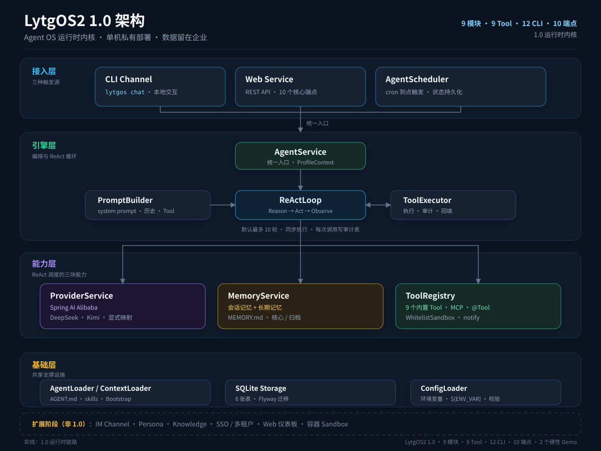

<div align="center">
  

  <h1>LytgOS2</h1>

  <p><strong>Java 原生、私有部署、可审计的企业级 Agent OS。</strong></p>
  <p>让企业像装一个 Spring Boot 应用一样，装一个 Agent 底座。</p>

  <p>
    
    
    
    
    
  </p>

  <p>
    <a href="README.md">English</a> · 简体中文
  </p>
</div>

LytgOS2 装在企业自己的 K8s、服务器或物理机上，作为跑一群业务 Agent 的统一底座。运维助手、客服助手、HR 助手、销售助手、知识管理助手都在同一个实例上运行，共享渠道接入、模型路由、工具调用、记忆、沙箱和审计能力。数据完全留在企业自己的基础设施里，不锁任何云生态。

业务方不写 Agent 后端代码：**写一个 `AGENT.md` 目录，配好模型和工具，Agent 就能跑起来。**

---

## 目录

- [项目简介](#项目简介)
- [项目状态](#项目状态)
- [为什么选择 LytgOS2](#为什么选择-lytgos2)
- [核心特性](#核心特性)
- [架构](#架构)
- [快速开始](#快速开始)
- [使用方式](#使用方式)
- [配置](#配置)
- [项目结构](#项目结构)
- [兼容性](#兼容性)
- [文档](#文档)
- [路线图](#路线图)
- [安全说明](#安全说明)
- [参与贡献](#参与贡献)
- [许可证](#许可证)
- [致谢](#致谢)

---

## 项目简介

LytgOS2 是一个用 Java 实现的企业级 **Agent OS**。它不是一个 Agent 框架，也不是一个工作流编排平台，而是一层装在企业自己基础设施上的运行时底座：向上承载多个业务 Agent，向下统一接入模型、工具、记忆、渠道和审计。

它解决的是「企业要同时跑 N 个 Agent 时，这些 Agent 共享的基础设施应该长什么样」这个问题。

| 维度 | LytgOS2 | 编排平台（Dify/Coze） | 框架（Spring AI/LangChain4j） |
|---|---|---|---|
| 产物 | 配置出来的常驻 Agent | 可执行的 workflow 流程 | 代码（库 / SDK） |
| 使用者 | 业务方（配置）+ 开发者（写 Tool） | 业务人员 / 开发者 | 开发者 |
| 运行环境 | 装在企业自己的基础设施上 | 平台自己的运行时 | 开发者自己搭 |
| 与 LytgOS2 的关系 | — | 可以作为 LytgOS2 的上层客户端 | LytgOS2 内部复用它们做 LLM 调用 |

**Agent OS 与 agent runtime 的区别：** runtime 让一个 Agent 跑起来，Agent OS 让一群 Agent 在企业里被管起来。LytgOS2 的内核包含一个 agent runtime，但在它之上还提供多 Agent 生命周期、统一接入、统一记忆、审计和治理。

---

## 项目状态

LytgOS2 目前处于**工程地基阶段**：九模块骨架和质量门禁已就位，下一步进入业务能力实现。1.0 的范围、命名和验收口径已在 [`docs/ReleaseBaseline.md`](docs/ReleaseBaseline.md) 锁定。

| 项目 | 状态 |
|---|---|
| 行业调研、需求文档、技术方案 | ✅ 完成 |
| 1.0 范围基线 | ✅ 完成 |
| Maven 工程与 Java 代码 | ✅ 九模块骨架完成，业务功能未实现 |
| 可执行版本 / CLI | 🚧 boot jar 可启动（health/info）；Agent 功能与 CLI 子命令未实现 |
| 测试、CI、质量门禁 | ✅ 工程地基已就位 |
| Agent 业务功能 | 🚧 未开始 |

> 当前仓库已初始化 Maven 九模块骨架和工程地基：Maven Wrapper、Spring Boot 3.5.16、Spring AI 1.1.2 + Spring AI Alibaba 1.1.2.4-security-fix、统一 API 信封、OpenAPI、结构化日志、虚拟线程，以及 Spotless/Checkstyle/PMD/SpotBugs/ArchUnit/JaCoCo 门禁。`./mvnw clean verify` 通过；`lytgos-boot` 暴露 `/api/v1/health`、`/api/v1/info` 和 `/v3/api-docs`。Agent 业务功能与 CLI 子命令尚未实现。

### 1.0 交付范围

| 项目 | 1.0 |
|---|---|
| Maven 模块 | 9 个 |
| 内置 Tool | 9 个 |
| CLI 命令 | 12 个 |
| REST 端点 | 10 个核心端点 + 支撑管理端点 |
| SQLite 表 | 6 张 |
| 验收 Demo | 2 个硬性 + 1 个可选 |
| JDK | 21 |

---

## 为什么选择 LytgOS2

**企业需要的不是「又一个 Agent 框架」，而是一个自己能掌控的底座。** 严监管企业有几条不会变的约束：核心数据不出企业、系统必须完全可审计、新组件要过现有安全流程、技术栈要跟现有体系对齐。SaaS 和绑定云生态的产品过不了这几条。

**开源 Agent OS 已经验证了设计。** OpenClaw 用 Node.js 验证了「装在自己机器上的 Agent 底座」，Hermes Agent 用 Python 验证了「工程级健壮性」。但两者都从个人和小团队起步，企业级治理、企业 IT 系统深度集成仍然留白。

**Java 生态有框架，没有底座。** Spring AI、Spring AI Alibaba、LangChain4j 解决了 LLM 调用和 Agent 开发库的问题。但 Java 企业如果要一个私有、可控、可审计的 Agent 底座，今天仍然只能跨栈使用 Node.js 或 Python 项目，再写大量胶水对接现有 Java 系统。

LytgOS2 锚定的不是「Agent OS」这个可能过时的词，而是严监管企业不会变的需求：**私有部署、完全可审计、数据不出企业、纳入现有 IT 治理、跟现有 Java 技术栈对齐。**

---

## 核心特性

| 特性 | 说明 |
|---|---|
| **对接 LLM** | Provider 抽象 + 显式 provider name 映射，Agent 不感知具体调的是哪家模型；1.0 至少跑通 DeepSeek 和 Kimi |
| **ReAct 循环** | 自实现 Reason + Act 循环，LLM 决定调哪个工具、看结果、继续推理，直到给出最终响应 |
| **两层 Memory** | 会话记忆 + 长期记忆；`MemoryService` 统一门面；1.0 长期记忆用 `MEMORY.md`，核心/归档双分区 |
| **Tool 体系** | 9 个内置 Tool、MCP Client、`@Tool` Java Bean；支持零代码接入现成 MCP，也支持自写 MCP server |
| **Web Service** | 10 个核心 REST 端点，业务系统通过 HTTP 接入；CLI、REST、定时任务共用同一条 Agent 链路 |
| **CLI Channel** | `lytgos chat/serve/gateway` 三种运行模式，共享同一份 Profile 和 Session 存储 |
| **定时任务** | `AgentScheduler` 按 cron 到点自动触发，状态与执行历史落 SQLite，可查、可手动补跑 |
| **审计地基** | `tool_invocations` 和 `llm_calls` 从 day one 写入，不是后期从日志反解析 |
| **接口先行** | Provider、Memory、Sandbox、Notify 都是先定接口再挂实现，扩展阶段换实现不改调用方 |

### 内置 Tool（1.0 共 9 个）

`read_file`、`write_file`、`list_dir`、`shell`、`http_get`、`http_post`、`save_memory`、`recall_memory`、`notify`。

文件、Shell、HTTP 和通知类 Tool 执行前都要通过 `WhitelistSandbox` 的应用层白名单校验。

---

## 架构

<p align="center">
  <a href="docs/images/architecture.svg">
    
  </a>
</p>

<p align="center"><sub>实线为 1.0 运行时链路；虚线区域为扩展阶段预留。点击图片可查看完整 SVG。</sub></p>

三个触发源——人推的 CLI、HTTP 调用，和钟推的定时任务——最终都汇入 `AgentService.process`。引擎不关心消息从哪个入口来。

`PromptBuilder` 每轮组装：Agent 指令 + Bootstrap + Memory + 对话历史 + 可用 Tool 列表，并在末尾注入当前日期时间。`ReActLoop` 默认最多 10 轮，每次 LLM 调用和 Tool 调用都写审计表。

1.0 是九个 Maven 模块组成的 Spring Boot 单体应用，单二进制部署。模块职责见[项目结构](#项目结构)。

---

## 快速开始

> ⚠️ 当前仓库尚无可运行代码。以下命令是 1.0 的目标用法，暂不可执行。

### 环境要求

| 项目 | 要求 |
|---|---|
| JDK | 21（1.0 基线） |
| Maven | 3.x |
| 部署系统 | Linux 主流发行版（Ubuntu 22.04+、CentOS 8+、Debian 11+、Alibaba Cloud Linux 3、Rocky Linux） |
| 开发系统 | Windows / macOS / Linux |

### 构建并启动骨架

```bash
git clone <repository-url>
cd lytgos2
./mvnw clean verify
java -jar lytgos-boot/target/lytgos-boot-1.0.0-SNAPSHOT.jar
```

Windows 使用 `mvnw.cmd` 替代 `./mvnw`。`mvn verify` 会跑完整质量门禁；`mvn package` 不会。

启动后验证：

```bash
curl http://localhost:8080/api/v1/health
```

> 当前骨架提供 `health` / `info` 两个系统端点和 `/v3/api-docs` OpenAPI 文档，Agent 功能尚未实现。仓库地址和 Git 仓库将在 1.0 发布前提供。
>
> Maven 必须运行在 JDK 21 上。如果 `mvn -v` 不是 JDK 21，请先将 `JAVA_HOME` 指向 JDK 21。

### 规划中的 Agent 用法

以下命令在 US-1 / US-2 完成后可用：

```bash
lytgos init
lytgos profile create daily-weather

# 编辑 .lytgos/agents/daily-weather/AGENT.md，配置 provider、tools 和任务指令
lytgos chat --profile daily-weather
lytgos serve
lytgos gateway
```

---

## 使用方式

### 一个目录 = 一个 Agent

Agent 不是写代码写出来的，而是一个自足的目录：

```text
.lytgos/agents/daily-weather/
├── AGENT.md          # frontmatter = 运行配置，正文 = 任务指令
├── skills/           # 指向 .lytgos/skills/<name>/ 的相对软连接
├── scripts/          # 可选脚本
└── REFERENCE.md      # 可选参考资料
```

`AGENT.md` 示例：

```markdown
---
name: daily-weather
description: 每日天气与穿搭建议
identity:
  agent_name: 天气助手
  prompt: 你是一个贴心的天气与穿搭助手
provider:
  name: deepseek
  model: deepseek-chat
tools:
  - http_get
  - notify
channels:
  - name: cli
bootstrap:
  - AGENTS.md
  - SOUL.md
  - USER.md
settings:
  max_iterations: 10
  max_history_turns: 20
---

你负责每天查询天气，生成简洁的穿搭建议，并通过 notify 推送到企业 IM 群。
```

- `AGENT.md` 正文和 Bootstrap 文件常驻 system prompt。
- 全局 Skill 存在 `.lytgos/skills/<name>/`；Agent 通过自己 `skills/` 下的相对软连接选择可见集合。
- 每轮只注入已绑定 Skill 的 name、description 和本地路径；正文、脚本和参考经 `read_file`/`shell` 按需读取。
- Agent 目录是上下文来源，不是 Tool，不进入 `ToolRegistry`。

### CLI

```bash
lytgos init                              # 初始化工作区
lytgos status                            # 查看配置和运行状态
lytgos chat [--profile <name>]           # 交互对话
lytgos serve                             # 启动 HTTP API
lytgos gateway                           # 启动多渠道守护进程
lytgos profile list|create|show|delete   # 管理 Agent 目录
lytgos provider list                     # 列出已配置的 Provider
lytgos tool list                         # 列出已注册的 Tool
lytgos session list                      # 列出会话历史
```

### HTTP API（核心端点）

| 类别 | 端点 |
|---|---|
| 会话管理 | `POST /api/v1/sessions`、`POST /api/v1/sessions/{id}/messages`、`GET /api/v1/sessions/{id}`、`DELETE /api/v1/sessions/{id}` |
| Agent 调用 | `POST /api/v1/agents/{name}/invoke` |
| 查询 | `GET /api/v1/profiles`、`GET /api/v1/memory`、`GET /api/v1/tools` |
| 系统状态 | `GET /api/v1/health`、`GET /api/v1/info` |

1.0 还提供 `notify-channels` 与 `scheduler v2` 的支撑管理端点，详见基线文档。

---

## 配置

### 命名约定

| 项目 | 值 |
|---|---|
| 产品名 | **LytgOS2** |
| CLI | `lytgos <command>` |
| 工作区 | `.lytgos/` |
| SQLite 数据库 | `.lytgos/lytgos.db` |
| Maven 模块 | `lytgos-*` |
| Spring 配置前缀 | `lytgos.*` |
| Java 类名前缀 | `Lytgos*`（如 `LytgosCli`） |

### 工作区结构

LytgOS2 的工作区默认是 `.lytgos/`：

```text
.lytgos/
├── agents/            # 每个子目录一个 Agent
├── skills/            # 全局 Skill 实体库
├── memory/
│   └── MEMORY.md      # 长期记忆
├── sessions/          # Session 数据
├── logs/              # 结构化日志
├── output/            # Agent 产出物
├── mcp_servers.yaml   # MCP 配置
├── AGENTS.md          # Bootstrap：项目级行为说明
├── SOUL.md            # Bootstrap：默认人格
├── USER.md            # Bootstrap：用户偏好
└── lytgos.db          # SQLite
```

### 配置与密钥

- 敏感配置通过环境变量或本地独立配置文件加载，`AGENT.md` 中使用 `${ENV_VAR}` 占位。
- `mcp_servers.yaml` 声明 MCP server 的 `name`、`transport`、`command`、`env`。
- 1.0 的 Provider 凭证不写入 `AGENT.md`，也不提交到仓库。
- 1.0 假设内网部署，没有认证和 RBAC。

---

## 项目结构

根 `pom.xml` 是聚合父 POM（`packaging=pom`），不包含源码；所有代码位于下面九个模块。

当前可执行入口是 `lytgos-boot` 的 `LytgosApplication`（Spring Boot fat JAR）；`lytgos-cli` 的 `LytgosCli` 是 Picocli 命令骨架，尚未打包成可直接执行的 `lytgos` 命令。

| 模块 | 职责 |
|---|---|
| `lytgos-core` | 核心契约与引擎：`LytgTool`、`Session`、`Profile`、`AgentLoader`、`ContextLoader`、`ReActLoop`、`PromptBuilder`、`ToolExecutor`、`AgentService`、`AgentScheduler` |
| `lytgos-provider` | `ProviderService`、Function Calling 适配、provider name → `ChatModel` 显式映射 |
| `lytgos-memory` | `MemoryService` 门面、`LongTermMemoryStore`、`MarkdownMemoryStore`、`MemoryTools` |
| `lytgos-tool` | 内置 Tool、MCP Client、`ToolRegistry`、`Sandbox` + `WhitelistSandbox`、`NotifyChannelAdapter` + `WebhookNotifyAdapter` |
| `lytgos-channel-cli` | `CliChannel`、`lytgos chat` 实现 |
| `lytgos-web` | `WebServer`、6 个 Controller、统一异常处理、OpenAPI、支撑管理端点 |
| `lytgos-storage` | SQLite、JPA Repository、Session / 审计 / 定时任务 / 通知渠道持久化、Flyway 迁移 |
| `lytgos-cli` | Picocli 主入口、12 个子命令、`ConfigLoader` |
| `lytgos-boot` | Spring Boot 主类、自动配置、依赖聚合、fat JAR 打包 |

技术栈：**JDK 21 + Spring Boot 3.5.x + Spring AI 1.1.x + Spring AI Alibaba 1.1.2.x + 自实现 ReAct loop + SQLite + Picocli + MCP Java SDK**。

---

## 兼容性

| 项目 | 支持范围 |
|---|---|
| JDK | 21（基线；允许 JDK 21+ 运行） |
| 操作系统 | Linux 主流发行版；开发环境支持 Windows / macOS / Linux |
| LLM 协议 | OpenAI 兼容协议是事实标准；实现该协议的 Provider 可以直接接入 |
| 部署形态 | 物理机、虚拟机、Docker、Kubernetes |
| 数据库 | SQLite（1.0 默认零配置） |

---

## 文档

| 文档 | 内容 |
|---|---|
| [`docs/ReleaseBaseline.md`](docs/ReleaseBaseline.md) | **1.0 唯一口径基线**：范围、命名、模块、Tool、命令、端点、Demo、冲突裁决 |
| [`docs/TechnicalSolution.md`](docs/TechnicalSolution.md) | 技术方案：架构、模块、数据模型、关键流程 |
| [`docs/DemandAnalysis.md`](docs/DemandAnalysis.md) | 需求文档：核心/扩展/社区三档需求与验收标准 |
| [`docs/IndustryResearch.md`](docs/IndustryResearch.md) | 行业调研：Agent OS 格局、Java 生态缺位、LytgOS2 定位 |
| [`docs/AiProgrammingGuide.md`](docs/AiProgrammingGuide.md) | AI 编程指南：Spec-Kit 流程与 US-1…US-5 实施顺序 |
| [`CLAUDE.md`](CLAUDE.md) | Claude Code 在本仓库工作的约定与架构速览 |

---

## 路线图

| 阶段 | 形态 | 重点 |
|---|---|---|
| **1.0（当前）** | 单机私有部署 | 运行时内核：五大核心能力、CLI/REST/定时三入口、审计地基 |
| **扩展阶段** | 企业级治理 | 多 IM Channel、Persona、Knowledge、向量记忆、Tool Policy、完整沙箱、SSO/多租户、完整审计、Web 仪表板 |
| **分布式阶段** | 多实例底座 | 实例无状态、状态外置、高可用、水平扩展 |
| **远期** | 分布式 Agent 协作 | 跨节点 / 跨组织 Agent 互发现、互委托，分布式 Agent OS |

### 1.0 明确不做

- IM 渠道：飞书、企业微信、钉钉、Slack
- Agent 生命周期：Persona、Knowledge、Agent 上传/生命周期 API、WorkspaceWatcher
- Memory：向量检索、SQLite/Mem0 后端、自动抽取
- 治理：Tool Policy、SSO、多租户、完整审计查询/SIEM 导出
- 沙箱与流式：完整容器沙箱、SSE/WebSocket、异步 Tool
- 运维：Web 仪表板、Provider fallback、集群部署、AgentScheduler 运行时 cron 增删改

完整的范围、数字和冲突裁决见 [`docs/ReleaseBaseline.md`](docs/ReleaseBaseline.md)。

---

## 安全说明

1.0 的安全能力是 **day one 设计，但不是完整企业级隔离**：

- Tool 执行经过应用层白名单：文件路径、Shell 可执行文件、HTTP 域名。
- 这是「劝阻级」防线，防的是模型误操作，不防蓄意绕过；不建议用 1.0 跑完全不可信的代码或对外做多租户。
- 1.0 假设内网部署，**没有认证和 RBAC**。
- 完整的容器/microVM Sandbox、SSO、RBAC、多租户隔离、审计查询和 SIEM 导出在扩展阶段补齐。
- 安全策略文档和漏洞报告流程将在 1.0 发布前补充。

---

## 参与贡献

LytgOS2 目前处于设计与脚手架阶段。1.0 完成前，协作以设计文档和 `ReleaseBaseline.md` 的口径为准；贡献指南、API 参考和部署手册会在 1.0 发布前后补齐。

开发使用 **Spec-Kit + Claude Code**：先把需求文档和技术方案转成 constitution / spec / plan，再按 `US-1 → US-2 →（US-3 ∥ US-4）→ US-5` 推进，每个 user story 结束跑一次 `analyze` 检查与基线的一致性。

提交代码或文档前，请确认：

- 不偏离 `docs/ReleaseBaseline.md` 的 1.0 范围
- 不引入旧的占位产品名或粘连的命名写法
- 修改设计决策时同步更新基线文档

---

## 许可证

LytgOS2 使用 [Apache License 2.0](LICENSE) 开源。你可以在许可证条款下使用、修改和分发本项目。

---

## 致谢

LytgOS2 的设计借鉴了开源 Agent OS 领域已经验证过的思路，并站在 Java AI 生态的基础上：

- [OpenClaw](https://github.com/openclaw/openclaw)：验证了「装在自己机器上的 Agent 底座」和目录形态的 Agent/Skill 设计
- [Hermes Agent](https://github.com/NousResearch/hermes-agent)：验证了工程级健壮性、三层记忆和 Skill 机制
- [Spring AI](https://docs.spring.io/spring-ai) / [Spring AI Alibaba](https://java2ai.com)：Java LLM 调用与主流模型 connector
- [Model Context Protocol](https://modelcontextprotocol.io)：Agent 与外部工具连接的开放协议
- [agentskills.io](https://agentskills.io)：Skill 目录与渐进式披露的开放标准

感谢这些项目和社区为 LytgOS2 提供的设计参考与基础设施。
